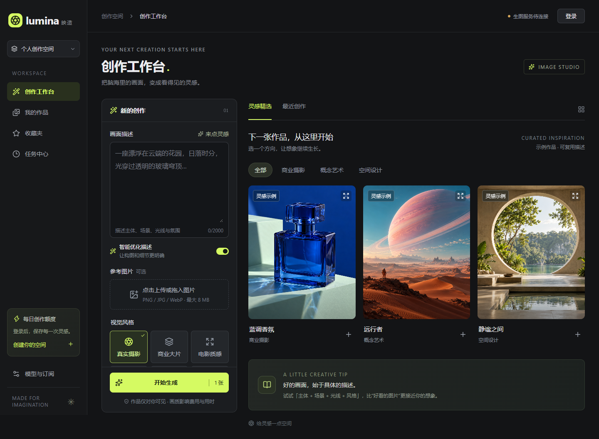
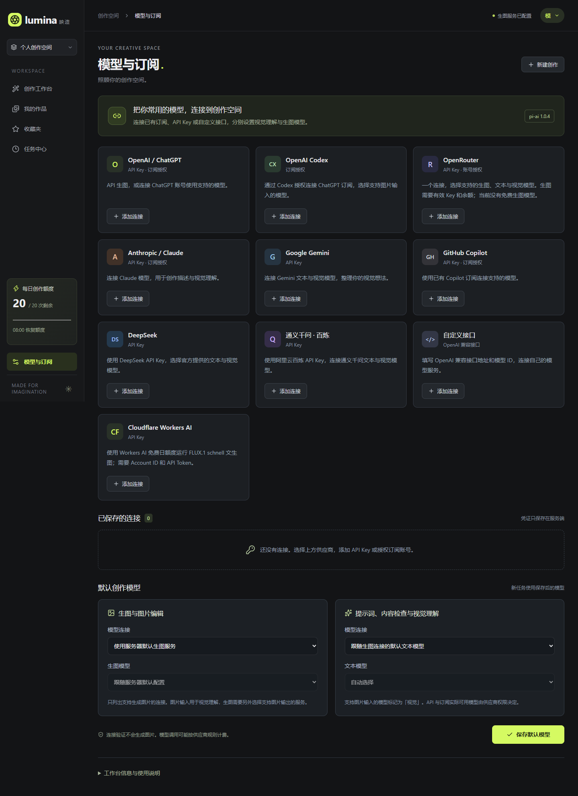
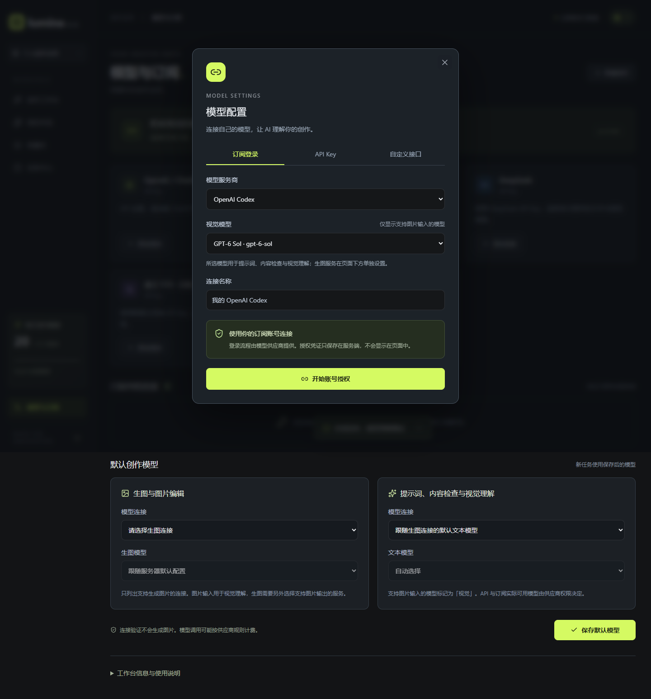

# Lumina 映造

面向商业素材制作与个人创作者的全栈 AI 生图应用。React + TypeScript 提供创作工作台，FastAPI 管理业务，Python LangGraph 编排生成 / 编辑流程。本地开发默认用 SQLite 和本机文件；免费公网体验配置使用 PostgreSQL 检查点与私有对象存储，避免 Render 免费实例休眠或重启后丢失数据。

公网体验地址：[Lumina AI](https://lumina-ai-studio-cfgg.onrender.com)。这是一个 Render 免费实例，首次访问或空闲后唤醒可能需要等待；真实生图需要在“模型与订阅”中配置可用的模型凭证。

## 功能

- 画面描述、六种风格、三种比例与画质；可选调用文本模型优化描述。
- 上传参考图，或从自己的作品继续编辑；收藏与原图下载。
- 真实任务进度与时间线，刷新页面仍保留记录。
- Cookie 登录、CSRF、个人图片归属检查、上传验证与限流。
- 原子预留账号 / 全站每日额度，请求幂等，结果不明时停止自动重试。
- LangGraph 持久化检查点、心跳租约、原图原子保存、最多两次归档恢复；本地使用 SQLite，公网可用 PostgreSQL。

运行入口直接调用 OpenAI Images / Responses / Moderations API，没有模拟生成开关。首页三张图片标为“灵感示例”。测试供应商替身只在隔离的测试服务中使用。

已增加 [模型与订阅配置](docs/MODEL_CONNECTIONS.md)：网页管理 OpenAI Codex 订阅、API Key、自定义 OpenAI 兼容接口，以及 OpenAI、DeepSeek、千问、OpenRouter、Cloudflare Workers AI 等供应商；默认生图与文本模型可分别保存。pi-ai 1.0.4 在服务端 Node 私有进程中运行；Python LangGraph 继续负责工作流。OpenAI 原生生图接口保留；OpenRouter 图像使用其专用 Images API 和实时模型能力目录；Cloudflare FLUX.1 schnell 使用 Workers AI REST API；文本 / 视觉理解使用 pi-ai。

## Windows 启动

需要 Node.js 24、Python 3.12。首次安装：

~~~powershell
cd E:\codex\lumina
.\scripts\setup.ps1
~~~

启动后登录，在“模型与订阅”添加 API Key 或授权已有订阅，再保存默认模型，无需重启。也可在本机 .env 填 OPENAI_API_KEY 作为服务器默认服务；默认 IMAGE_MODEL=gpt-image-2.5-sunburst。网页中的个人 OpenAI 连接使用官方地址；.env 中的服务器默认连接仍支持可信 HTTPS 代理。密钥不要进入聊天、前端代码或 GitHub。

~~~powershell
.\scripts\start.ps1
~~~

打开 [工作台](http://127.0.0.1:8090/studio) 和 [API 文档](http://127.0.0.1:8090/api/docs)。改动 .env 后重启进程；连接标记只说明配置已加载，实际权限与余额需要真实生成验证。

开发前端时另开终端运行 npm run dev，打开 http://127.0.0.1:5173；API 仍使用 8090 后端。正式入口由 FastAPI 同源提供 dist 与 API。

## 代码结构

| 路径 | 责任 |
| --- | --- |
| src/ | 创作、作品库、收藏、任务与设置 |
| server/main.py | API、SSE、上传、私有图片、静态资源 |
| server/db.py | 事务队列、业务数据、额度与幂等 |
| server/workflow.py | LangGraph 条件节点与副作用 |
| server/worker.py | 异步消费者、租约、心跳与恢复 |
| server/provider.py | OpenAI 适配、错误分类、解码 |
| server/model_service.py、vault.py | 模型配置、授权状态、凭证加密和归属 |
| server/model_provider.py | 每个任务的模型路由与连接绑定 |
| bridge/ | pi-ai 模型目录、SDK 调用与私有 IPC |
| server/ops.py | 结果不明任务的离线核对 |
| server/migrations/ | 版本化 SQL |
| tests/、e2e/ | 后端与浏览器测试 |
| docs/ | 架构、部署、验收、简历与面试材料 |

[架构说明](docs/ARCHITECTURE.md) · [部署说明](docs/DEPLOYMENT.md) · [验收记录](docs/VALIDATION.md) · [简历材料](docs/RESUME.md)

## 接口

| 操作 | 接口 |
| --- | --- |
| 注册 / 登录 / 退出 / 当前账号 | /api/auth/register、login、logout、me |
| 创建 / 个人历史 | POST /api/jobs、GET /api/jobs |
| 详情 / 实时事件 | GET /api/jobs/{id}、/api/jobs/{id}/events |
| 取消排队 | POST /api/jobs/{id}/cancel |
| 收藏 / 移出 | PATCH /api/jobs/{id}、DELETE /api/jobs/{id} |
| 上传 / 查看 / 下载 | POST /api/assets、GET /api/assets/{id}?download=true |

修改操作要求 X-Lumina-Client: web；登录后还要求 X-CSRF-Token（登录结果或 /api/auth/me 返回）。创建任务需要 UUID 格式 Idempotency-Key。前端不在 localStorage 保存登录令牌。上传使用原始图片请求体，不接受外部图片 URL。

## 测试

~~~powershell
npm run build
npm run test:bridge
.\.venv\Scripts\python.exe -m ruff check server tests
.\.venv\Scripts\python.exe -m pytest --cov=server --cov-report=term-missing
npm run test:e2e
npm audit --audit-level=high
.\.venv\Scripts\python.exe -m pip_audit --disable-pip --no-deps -r requirements.lock
~~~

Windows 使用已安装的 Edge，Linux CI 使用 Playwright Chromium。测试数据库独立且临时；测试服务强制空 API 密钥，绝不访问付费模型。HTTP MockTransport 检查真实 OpenAI SDK 请求格式与异常行为。

## 零月费体验版

`render.yaml` 采用 Render 免费 Docker Web Service + Supabase 免费 PostgreSQL / 私有 Storage。首次访问或空闲 15 分钟后再次访问时，Render 可能需要约一分钟启动；Supabase 免费项目若一周没有足够活动可能暂停。免费额度和规则以供应商当前页面为准，适合简历演示与小规模体验，不应当作稳定生产承诺。

线上访客注册后填写自己的模型 API Key；密钥只发到 Lumina 服务端并加密保存。Lumina 不替用户付模型调用费；用户仍按其模型供应商的价格付费。请按照[公网体验部署步骤](docs/DEPLOYMENT.md#零月费公网体验)配置 Supabase 与 Render 环境变量。不要公开 Supabase service-role key 或 Fernet 加密密钥。

## 部署与边界

~~~powershell
docker compose up --build -d
~~~

Docker 配置含非 root 用户和健康检查。此版本是单实例部署：一个 Uvicorn 进程与异步工作池；免费公网实例的本机磁盘只用于临时文件，账号、任务和图片分别写入 PostgreSQL 与私有对象存储。公网应设置真实 APP_ORIGINS 与 COOKIE_SECURE=true，并使用 HTTPS。

额度按 UTC 日历日恢复，界面转为浏览器本地时间；生成次数不等于货币预算，供应商账户仍应设置消费预算。不同画质和描述优化的费用不同。

原始描述、优化描述、参考图与原图保存在本机 / 服务器，并在生成时发往配置的模型服务。“移出作品库”是软删除，不承诺永久擦除。当前没有邮箱验证、密码找回、支付、团队协作、多实例基础设施或自动存储回收。

API Key 与 OAuth 凭证通过账户绑定的 Fernet 加密保存。本地使用 data/credentials.key；公网版本使用 Render 上稳定的 CREDENTIAL_ENCRYPTION_KEY。丢失或更换该密钥后，已有模型连接无法解密；列出连接不会解密、回显完整凭证或刷新账号授权。真实订阅权限仍需你本人完成供应商授权并验证。

源码与隔离业务链路已提供；公网体验服务已经部署并通过首页与 `/api/health` 检查。真实模型生成仍需在页面连接可用凭证后单独验收；该部署面向简历演示和小规模体验，不提供生产级 SLA。

## 参考资料

- [OpenAI 图像生成官方文档](https://developers.openai.com/api/docs/guides/image-generation)
- [LangGraph 持久化](https://docs.langchain.com/oss/python/langgraph/persistence)
- [LangGraph 检查点](https://docs.langchain.com/oss/python/langgraph/checkpointers)

示例图片由内置 ImageGen 生成，[素材提示词与来源](docs/image-provenance.json) 已保存。
